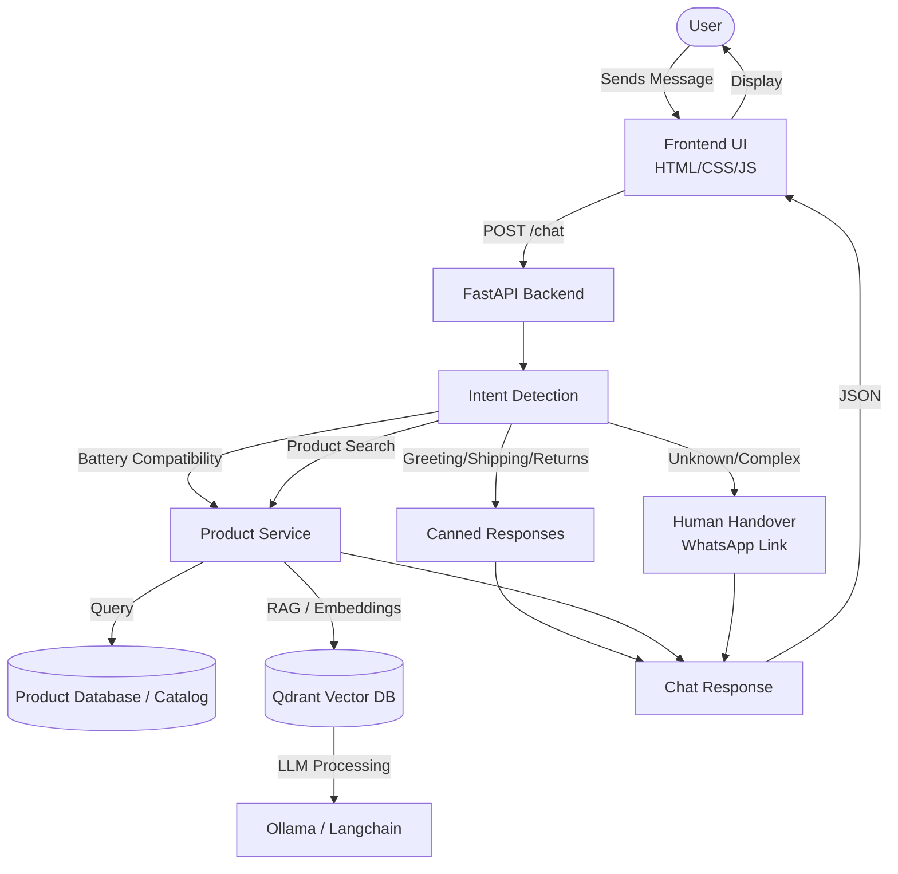

# Lapalfa AI Customer Support Chatbot

Lapalfa AI Customer Support Chatbot is an intelligent assistant designed to help customers with product searches, battery compatibility queries, order tracking, and general support. It uses a modern RAG (Retrieval-Augmented Generation) pipeline backed by Qdrant and Ollama, and falls back to human handover via WhatsApp when necessary.

## Architecture Diagram



## Features

- **Intent Detection:** Automatically categorizes user queries into intents like shipping, returns, compatibility, or product search.
- **RAG-Powered Knowledge Base:** Leverages Langchain, Qdrant (Vector Database), and Ollama (Local LLMs) to search and retrieve accurate information from the internal knowledge base.
- **Battery Compatibility Check:** Allows users to find laptop batteries compatible with their specific laptop models.
- **Product Search:** Real-time lookup of product prices, images, and availability.
- **Human Handover:** If the bot cannot confidently answer a query, it provides a seamless handover to a human agent via WhatsApp.
- **Canned Responses:** Fast and reliable answers for common queries like shipping policies and return procedures.

## Tech Stack

- **Backend:** FastAPI, Python, Langchain, Sentence-Transformers
- **Frontend:** HTML, CSS, JavaScript (Vanilla)
- **Vector Database:** Qdrant
- **LLM / Embeddings:** Ollama
- **Dependency Management:** `uv` (pyproject.toml)

## Folder Structure

```
.
├── backend/            # FastAPI application and routes
├── data/               # Knowledge base Markdown files and product data
├── frontend/           # HTML, CSS, and JS files for the chat interface
├── src/
│   └── lapalfa_chatbot/# Core RAG logic, knowledge loaders, and intent detection
├── README.md           # Project documentation
├── pyproject.toml      # Dependencies and project metadata
└── uv.lock             # Lockfile for reproducible builds
```

## Getting Started

### Prerequisites

- Python >= 3.14 (or compatible version as per pyproject.toml)
- [uv](https://github.com/astral-sh/uv) for dependency management
- [Ollama](https://ollama.com/) running locally for LLM inference

### Installation

1. **Clone the repository:**
   ```bash
   git clone https://github.com/sanjit507/lapalfa-ai-customer-support-chatbot.git
   cd lapalfa-ai-customer-support-chatbot
   ```

2. **Install dependencies:**
   ```bash
   uv sync
   ```

### Running the Application

1. **Start the Backend:**
   Run the FastAPI server from the `backend` directory.
   ```bash
   cd backend
   uvicorn main:app --reload
   ```
   The API will be available at `http://localhost:8000`.

2. **Start the Frontend:**
   Simply open `frontend/index.html` in your web browser, or use a simple HTTP server:
   ```bash
   cd frontend
   python -m http.server 3000
   ```
   Access the chat interface at `http://localhost:3000`.

## Contact & Support

For human support, users are redirected to WhatsApp: +91 94729 37493.
