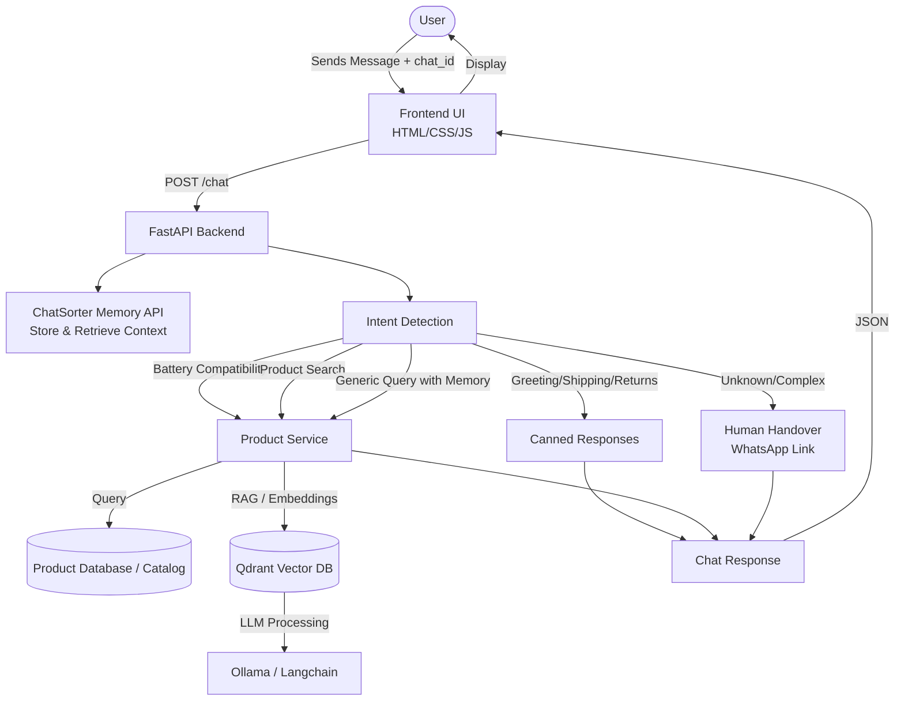

# Lapalfa AI Customer Support Chatbot

Lapalfa AI Customer Support Chatbot is an intelligent assistant designed to help customers with product searches, battery compatibility queries, order tracking, and general support. It uses a modern RAG (Retrieval-Augmented Generation) pipeline backed by Qdrant and Ollama, integrates **ChatSorter** for persistent conversation memory across sessions, and falls back to human handover via WhatsApp when necessary.

## Architecture Diagram



## Features

- **Intent Detection:** Automatically categorizes user queries into intents like shipping, returns, compatibility, or product search.
- **Persistent Conversation Memory (ChatSorter):** Stores context and remembers customer laptop models, preferences, and details across the conversation session using ChatSorter's memory API.
- **Battery Compatibility Check:** Allows users to find laptop batteries compatible with their specific laptop models.
- **Product Search:** Real-time lookup of product prices, images, and availability.
- **RAG-Powered Knowledge Base:** Leverages Langchain, Qdrant (Vector Database), and Ollama (Local LLMs) to search and retrieve accurate information from the internal knowledge base.
- **Human Handover:** If the bot cannot confidently answer a query, it provides a seamless handover to a human agent via WhatsApp.
- **Canned Responses:** Fast and reliable answers for common queries like shipping policies and return procedures.
- **Integrated Full-Stack Server:** FastAPI serves both the backend API and frontend interface directly from a single port.

## Tech Stack

- **Backend:** FastAPI, Python, Langchain, Sentence-Transformers
- **Frontend:** HTML, CSS, JavaScript (Vanilla)
- **Memory Management:** [ChatSorter API](https://chatsorter.com) (`/sdk/v1`)
- **Vector Database:** Qdrant
- **LLM / Embeddings:** Ollama
- **Dependency Management:** `uv` (pyproject.toml)

## Folder Structure

```
.
├── backend/            # FastAPI application and routes (serves API & static UI)
├── data/               # Knowledge base Markdown files, products catalog, and Qdrant storage
├── frontend/           # HTML, CSS, and JS files for the chat interface
├── src/
│   └── lapalfa_chatbot/
│       ├── memory.py   # ChatSorter conversation memory integration
│       ├── intent.py   # Query intent classification
│       ├── product_service.py # Compatibility and search service
│       └── ...         # Core RAG logic, loaders, and vector store
├── .env.example        # Environment variable template
├── README.md           # Project documentation
├── pyproject.toml      # Dependencies and project metadata
└── uv.lock             # Lockfile for reproducible builds
```

## Getting Started

### Prerequisites

- Python >= 3.12 (or compatible version as per pyproject.toml)
- [uv](https://github.com/astral-sh/uv) for dependency management
- [Ollama](https://ollama.com/) running locally for LLM inference (optional for local RAG)

### Installation

1. **Clone the repository:**
   ```bash
   git clone https://github.com/sanjit507/lapalfa-ai-customer-support-chatbot.git
   cd lapalfa-ai-customer-support-chatbot
   ```

2. **Set up Environment Variables:**
   Copy the example environment file:
   ```bash
   cp .env.example .env
   ```
   Add your ChatSorter API key in `.env`:
   ```env
   CHATSORTER_API_KEY=your_chatsorter_key_here
   CHATSORTER_API_URL=https://api.chatsorter.com
   ```

3. **Install dependencies:**
   ```bash
   uv sync
   ```

### Running the Application

Start the server using `uvicorn`:
```bash
uvicorn backend.main:app --reload
```

Open your browser and navigate to:
```
http://127.0.0.1:8000
```
FastAPI automatically serves both the interactive chat interface and the backend API on the same port.

## Contact & Support

For human support, users are redirected to WhatsApp: +91 94729 37493.
